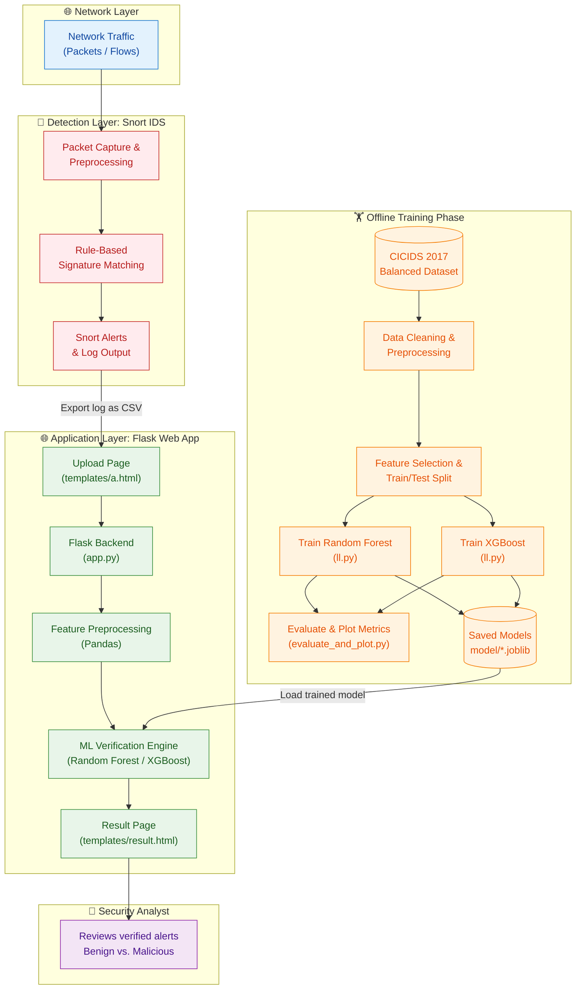
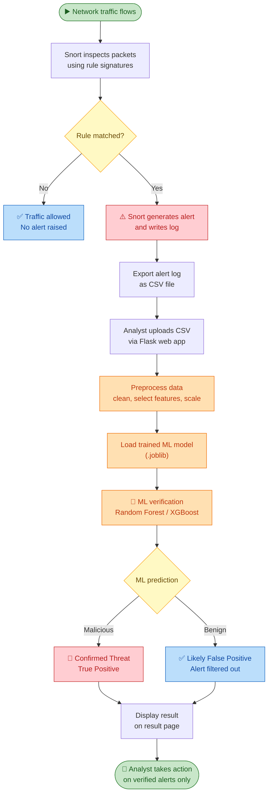
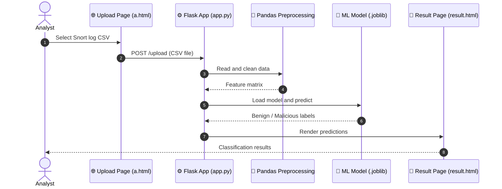
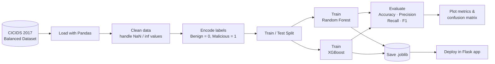
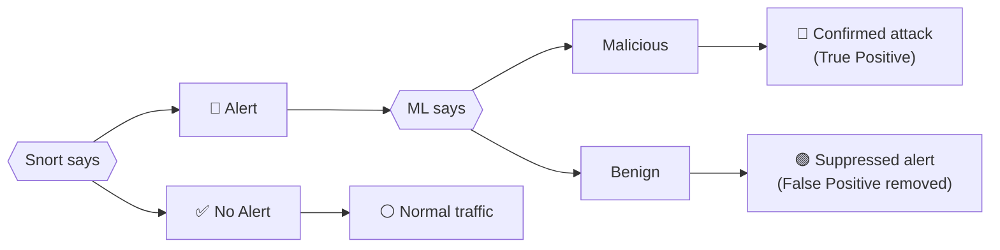

<div align="center">

# 🛡️ Enhancing Snort-Based Intrusion Detection with Machine Learning IP Verification

**A hybrid IDS that combines Snort's rule-based detection with machine learning (Random Forest & XGBoost) to verify alerts, cut false positives, and classify network traffic as Benign or Malicious in real time, served through a Flask web app.**


</div>

---

## 📑 Table of Contents

- [Overview](#-overview)
- [Screenshots](#-screenshots)
- [Key Features](#-key-features)
- [System Architecture](#-system-architecture)
- [Workflow Diagrams](#-workflow-diagrams)
- [Machine Learning Pipeline](#-machine-learning-pipeline)
- [Results](#-results)
- [Tech Stack](#-tech-stack)
- [Project Structure](#-project-structure)
- [Getting Started](#-getting-started)
- [Usage](#-usage)
- [Future Enhancements](#-future-enhancements)
- [Author](#-author)

---

## 📖 Overview

Traditional signature-based IDS tools like **Snort** are fast and reliable at detecting known attack patterns, but they often generate a high number of **false positives**, which overwhelms security analysts.

This project adds a **machine learning verification layer** on top of Snort alerts. Each alert is re-evaluated by trained **Random Forest** and **XGBoost** classifiers, which confirm whether the traffic is truly **Malicious** or actually **Benign**. This reduces the false positive rate from **~18% to ~5%**.

---

## 🖼️ Screenshots


## ✨ Key Features

- 🔗 **Hybrid Snort + ML detection pipeline**
- 🌲 **Random Forest & XGBoost** classifiers trained on the **CICIDS 2017 Balanced Dataset**
- 🌐 **Flask web interface**: upload a Snort log CSV and get an instant classification
- 📉 **False positive rate reduced** from ~18% to ~5%
- ⚡ Real-time Benign vs. Malicious traffic classification

---

## 🏗️ System Architecture

The system has two parts. An **offline training phase** builds the models, and an **online detection phase** verifies Snort alerts through the web app.



### Component Summary

| Component | File / Tool | Responsibility |
|---|---|---|
| **Snort IDS** | Snort | Rule-based packet inspection and alert generation |
| **Training Script** | `training/ll.py` | Trains Random Forest and XGBoost models |
| **Evaluation Script** | `training/evaluate_and_plot.py` | Computes metrics and generates plots |
| **Model Store** | `model/*.joblib` | Persisted trained model artifacts |
| **Flask App** | `app.py` | Handles upload, preprocessing, prediction, and response |
| **Templates** | `a.html`, `result.html` | Upload UI and classification result UI |

---

## 🔄 Workflow Diagrams

### 1️⃣ End-to-End Detection Workflow



### 2️⃣ Web Application Request Flow



### 3️⃣ Model Training Workflow (Offline)



### 4️⃣ Hybrid Decision Logic



---

## 🧠 Machine Learning Pipeline

| Stage | Description |
|---|---|
| **Dataset** | CICIDS 2017 Balanced Dataset (benign and attack network flows) |
| **Preprocessing** | Cleaning, handling missing and infinite values, feature selection |
| **Models** | Random Forest and XGBoost classifiers |
| **Task** | Binary classification: **Benign** vs. **Malicious** |
| **Evaluation** | Accuracy, Precision, Recall, F1-Score |
| **Persistence** | Models saved as `.joblib` artifacts for reuse in the web app |

**Why add ML to Snort?**
- 🎯 Snort rules are static, so they can flag harmless traffic that merely resembles an attack
- 🤖 ML learns patterns from flow features and can separate real threats from noise
- 📉 The combination keeps Snort's speed and cuts analyst alert fatigue

---

## 📊 Results

| Model | Accuracy | Precision | Recall | F1-Score |
|---|:---:|:---:|:---:|:---:|
| Random Forest | 94.33% | 93.80% | 94.10% | 94.00% |
| **XGBoost** | **95.45%** | **95.00%** | **95.30%** | **95.25%** |

```mermaid
xychart-beta
    title "Model Performance Comparison (%)"
    x-axis ["Accuracy", "Precision", "Recall", "F1-Score"]
    y-axis "Score (%)" 90 --> 100
    bar [94.33, 93.80, 94.10, 94.00]
    bar [95.45, 95.00, 95.30, 95.25]
```


> 🟦 Random Forest  |  🟧 XGBoost

### False Positive Reduction

| Detection Approach | False Positive Rate |
|---|:---:|
| Snort alone | ~18% |
| **Snort + ML verification** | **~5%** |

---

## 🛠️ Tech Stack

| Category | Technologies |
|---|---|
| **Language** | Python |
| **Web Framework** | Flask |
| **Machine Learning** | Scikit-learn, XGBoost |
| **Data Processing** | Pandas |
| **IDS** | Snort |
| **Dataset** | CICIDS 2017 |

---

## 📂 Project Structure

```
snort_webapp/
├── app.py                  # Flask app
├── templates/              # a.html (upload), result.html (output)
├── training/               # ll.py (train), evaluate_and_plot.py (metrics)
├── model/                  # Saved .joblib model artifacts
└── requirements.txt
```

---

## 🚀 Getting Started

### Prerequisites
- Python 3.8+
- pip
- *(Optional)* Snort installed, if you want to generate your own alert logs

### 1. Clone the repository
```bash
git clone https://github.com/DharaniSiva78/Enhancing-Snort-Based-Intrusion-Detection-with-Machine-Learning-IP-Verification-.git
cd Enhancing-Snort-Based-Intrusion-Detection-with-Machine-Learning-IP-Verification-/snort_webapp
```

### 2. Create a virtual environment *(recommended)*
```bash
python -m venv venv
source venv/bin/activate        # Linux / macOS
venv\Scripts\activate           # Windows
```

### 3. Install dependencies
```bash
pip install -r requirements.txt
```

### 4. Train the models *(skip if `model/` already has `.joblib` files)*
```bash
python training/ll.py
```

### 5. Evaluate and plot metrics *(optional)*
```bash
python training/evaluate_and_plot.py
```

### 6. Run the web app
```bash
python app.py
```
Then open **http://127.0.0.1:5000** in your browser.

---

## 💻 Usage

1. Open the web app in your browser.
2. Upload a **Snort log CSV** file on the upload page.
3. The app preprocesses the data and runs it through the trained model.
4. View the **Benign / Malicious** classification on the result page.
5. Act only on alerts that the ML layer confirms as malicious.

---

## 🔮 Future Enhancements

- 📡 Real-time Snort log streaming instead of manual CSV upload
- 🌍 Threat intelligence feeds for IP reputation checks
- 🧬 Deep learning models (LSTM / CNN) for sequence-based detection
- 📈 Dashboard with live alert statistics and charts
- 🧩 Multi-class attack classification (DoS, PortScan, Brute Force, etc.)
- 🐳 Docker containerization for easy deployment
- 🔔 Email and Slack alerts for confirmed threats

---

## 👤 Author

**Dharani Siva**
GitHub: [@DharaniSiva78](https://github.com/DharaniSiva78)

---

<div align="center">

⭐ If you found this project useful, please consider giving it a star!

</div>
